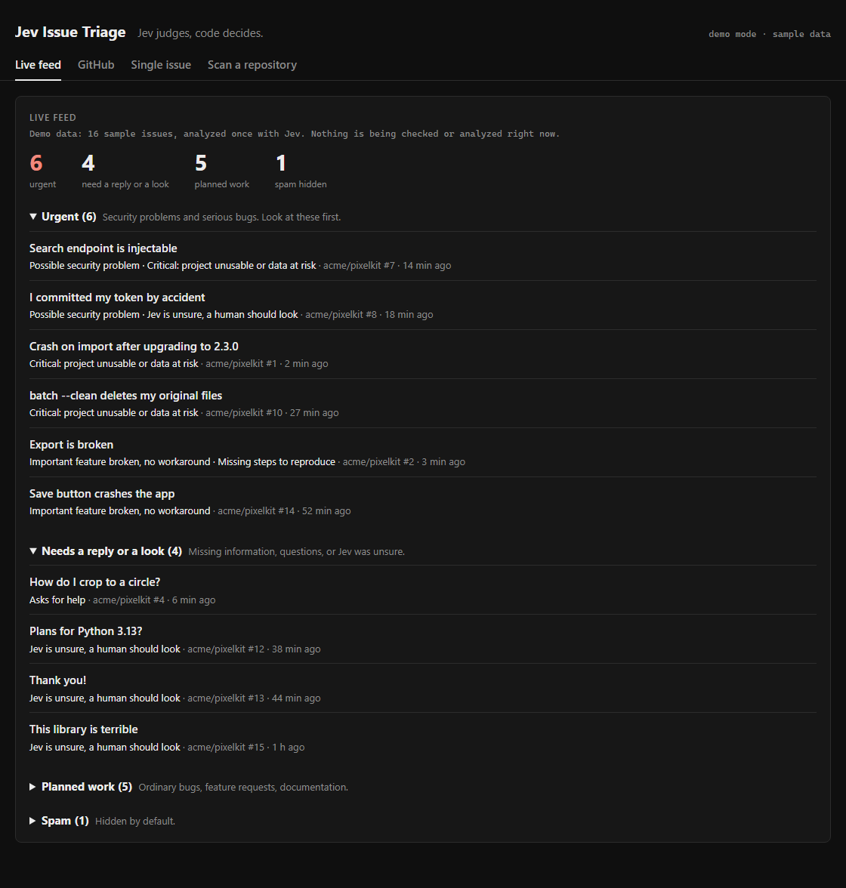
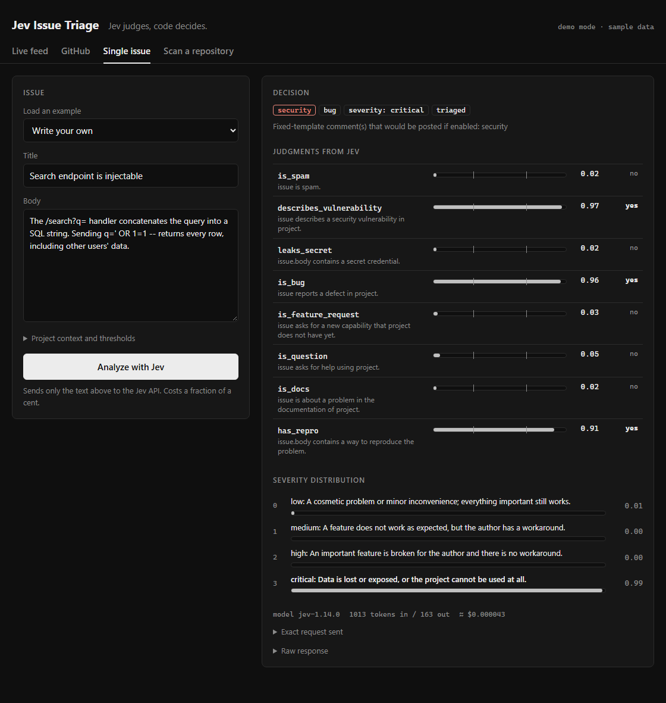

# Jev Issue Triage

[](https://github.com/elcann7/jev-issue-triage/actions/workflows/ci.yml)
[](LICENSE)
[](package.json)

**Label and prioritize new GitHub issues with [TypeSafe's Jev](https://typesafe.ai) model. Jev judges, your code decides.**

A GitHub Action that reads every new issue, labels it (`bug`, `enhancement`, `question`, `documentation`, `needs-repro`,
`security`, `spam`, `severity: ...`) and tells you which ones need attention first. An optional local dashboard shows
the backlog grouped by urgency.

> Unofficial community project, not affiliated with TypeSafe AI. It targets TypeSafe's API, which is in early access.
> Read [Limitations](#limitations) and [Safety and privacy](#safety-and-privacy) before using it on a real project.



## Why

Maintainers of busy projects spend a lot of time reading issues just to decide which ones matter. A chat model that
writes text is a poor fit for that: you have to parse free-form output and trust it to decide for you.

Jev is different. It does not write text. You send it a piece of text and a few typed questions ("does this report a defect?",
"does it include steps to reproduce?") and it answers with probabilities. This project keeps that clean split:

- **Jev makes small judgments**, one question at a time, each with a probability.
- **Plain code makes the decisions.** A short, readable, tested decision table ([`src/decide.mjs`](src/decide.mjs)) turns those
  probabilities into labels. The model never picks a label name and never writes a comment.

That makes the behavior auditable and easy to change: edit a question or a threshold, run the tests, done.

## Quick start (GitHub Action)

You need a repository with issues enabled and a TypeSafe API key from <https://console.typesafe.ai/keys>.

**1. Add the key as a secret.** Repository **Settings > Secrets and variables > Actions > New repository secret**, name it
`TYPESAFE_API_KEY`.

**2. Add a workflow** at `.github/workflows/triage.yml`:

```yaml
name: Triage new issues
on:
  issues:
    types: [opened]

permissions:
  issues: write   # only labels and comments; no other permission is needed

jobs:
  triage:
    runs-on: ubuntu-latest
    steps:
      - uses: elcann7/jev-issue-triage@v0.1.0
        with:
          api_key: ${{ secrets.TYPESAFE_API_KEY }}
          dry_run: "true"   # start here: decisions appear in the job summary, nothing is changed
```

**3. Open a test issue.** Go to the **Actions** tab, open the run, and read the job summary. It lists every question,
its probability, and the labels that would be applied.

**4. When you trust the results, set `dry_run: "false"`.** The Action now adds the labels. Labels that do not exist yet are
created by GitHub with a default color; create them yourself first if you want custom colors.

No `npm install` is needed: the Action has no dependencies.

### Inputs

| Input | Default | Description |
|---|---|---|
| `api_key` | required | TypeSafe API key. Store it as a repository secret. |
| `github_token` | `${{ github.token }}` | Token used to add labels and comments. Needs `issues: write`. |
| `dry_run` | `false` | `true`: compute and print the decision, change nothing. |
| `comment` | `false` | `true`: post **fixed-template** comments (ask for reproduction steps, point to private security reporting). |
| `model` | `jev-latest` | Jev model name or alias. |
| `threshold_high` | `0.7` | A probability at or above this reads as yes. |
| `threshold_low` | `0.3` | A probability at or below this reads as no. Between the two is "unsure". |
| `max_body_chars` | `6000` | The issue body is cut at this length before it is sent. |
| `base_url` | `https://api.typesafe.ai` | Only change this to test against a mock server. |

### Outputs

| Output | Description |
|---|---|
| `labels` | Comma-separated labels the code decided on (empty when skipped). |
| `tier` | `urgent`, `attention`, `planned` or `spam` (empty when skipped). |
| `skipped` | `true` for pull requests, bot authors, already triaged issues and any action other than `opened`. |

Use them in later steps, for example to ping a channel when `steps.triage.outputs.tier == 'urgent'`.

## What it decides

| Label | Applied when |
|---|---|
| `bug`, `enhancement`, `question`, `documentation` | Jev's probability for that kind is high. Several can apply at once. |
| `needs-triage` | No kind is clearly true. A human should look. |
| `severity: low / medium / high / critical` | For bugs: the most likely level of a four-level score. |
| `needs-repro` | A bug whose body clearly lacks a way to reproduce it. |
| `security` | A described vulnerability, or a leaked credential. |
| `spam` | Clearly spam. Nothing else is applied. |
| `triaged` | Always added, so an issue is never processed twice. |

Each issue also gets a **priority tier** and a one-line reason from a fixed table in code:

| Tier | Meaning |
|---|---|
| `urgent` | Security problem, or a critical or serious bug. |
| `attention` | Missing reproduction steps, a question, or Jev was unsure: someone should reply or look. |
| `planned` | Ordinary bugs, feature requests, documentation. |
| `spam` | Hidden by default in the dashboard. |

### The questions

Jev answers nine independent questions per issue (see [`src/questions.mjs`](src/questions.mjs)): `is_bug`, `is_feature_request`,
`is_question`, `is_docs`, `has_repro`, `describes_vulnerability`, `leaks_secret`, `is_spam` and a four-level `severity` score.
Each asks for one judgment a person could make at a glance. All of them are sent in a single request, and the
probabilities become `yes` (>= 0.7), `no` (<= 0.3) or `unsure` (in between). "Unsure" is a real outcome: for example a bug with
unsure reproduction steps does **not** get `needs-repro`.

### Customizing

Fork the repository and edit the question wording in `src/questions.mjs` or the rules in `src/decide.mjs`. The decision table is covered
by tests, including every threshold boundary. Run `npm test`, then `npm run eval` (see [Evaluation](#evaluation)) to check the effect.

## Local dashboard (optional)

A small dependency-free web app that shows the backlog grouped by urgency, lets you connect your GitHub account, and can watch
repositories automatically. It is a single-user tool for your own machine.

**Try it right now, no API key and no network needed:**

```bash
git clone https://github.com/elcann7/jev-issue-triage.git
cd jev-issue-triage
npm run demo          # open http://localhost:4173
```

Demo mode shows 16 sample issues that were analyzed once with Jev ([`docs/demo-store.json`](docs/demo-store.json)). Click any issue to see every
probability and the exact request that was sent:



**Run it for real:**

```bash
cp .env.example .env  # Windows: copy .env.example .env   then put your TYPESAFE_API_KEY in .env
npm run dashboard     # http://localhost:4173
```

The dashboard has four tabs:

- **Live feed**: issues grouped into Urgent, Needs a reply or a look, Planned work and Spam, with a one-line reason each.
  A background watcher checks the repositories you chose every few minutes and analyzes only new issues. A restarted server never
  re-analyzes an issue. **Settings** (collapsible) lets you change the daily limit, issues per check, check interval and list length;
  it estimates the cost as you type.
- **GitHub**: connect your account, see your repositories and their open issues, analyze one issue, or press **Watch**.
- **Single issue**: paste any issue text and inspect every probability. Changing the thresholds re-decides instantly and for free.
- **Scan a repository**: paste `owner/name` or any github.com link and get the same grouped view for its latest open issues.

**Connecting GitHub.** Two ways: the **GitHub CLI** login already on your computer (one click), or **Sign in with GitHub** (OAuth device
flow). The second needs a GitHub OAuth App with *Device Flow* enabled: create one at **Settings > Developer settings > OAuth Apps**
and put its client id in `.env` as `GITHUB_CLIENT_ID`. The token stays in the server's memory (never written to disk, never sent to the
browser), and the server only makes read (GET) requests to GitHub.

Environment variables (all optional except the key): `TYPESAFE_API_KEY`, `GITHUB_TOKEN` (raises GitHub rate limits), `GITHUB_CLIENT_ID`,
`PORT` (default 4173), `AUTO=0` (disable the watcher), `JEV_MODEL`.

The server listens on `127.0.0.1` only, checks the Host and Origin headers on every state-changing request, and rate-limits manual analysis.

## Safety and privacy

- **Issue text is untrusted input.** It is sent to Jev as data and could try to steer an answer. That is why labels come only from a
  fixed list and comments only from fixed templates: nothing the model returns is executed or posted. The test set includes a prompt-injection
  case (see [Evaluation](#evaluation)).
- **The Action needs only `issues: write`.** The API key lives in repository secrets and is never logged (this is tested).
- **Errors are never disguised as answers.** A failed API call fails the job loudly and applies no labels.
- **Issue text leaves your repository.** Every analyzed issue's title and body are sent to the TypeSafe API. The provider's data retention and
  training policy was not stated in the documentation this project was built from. Do not use it on repositories whose issues contain
  confidential information until you have read TypeSafe's terms. The dashboard asks for explicit confirmation before it sends text from a
  **private** repository.
- Bot-created issues, pull requests, already `triaged` issues and every event except `opened` are skipped.

## Evaluation

[`examples/issues.json`](examples/issues.json) contains 16 **synthetic** issues with expected labels, including hard cases: a feature request phrased as a bug,
a thank-you note, a rant, a prompt-injection attempt, and a leaked credential. Run it yourself (costs about $0.001):

```bash
npm run eval            # shows what would be sent and the estimated cost, sends nothing
npm run eval -- --yes   # sends the 16 issues and prints the mismatches
```

Latest run: **65 of 66 checks passed**. An earlier run scored 63 of 66, and the difference is worth knowing:

- A leaked-token test issue said "(fake example)" inside its text. That told the model the secret was fake, and it was not flagged
  (`leaks_secret` 0.41 against 0.98 once the phrase was removed). The fixture, not the model, was at fault, so the fixture was changed
  to a realistic-looking synthetic key.
- One issue ("I read the docs but could not find how to apply a mask") sits right on the threshold for `documentation` (0.70). Results that
  close to a threshold can flip between runs.
- The one remaining miss: a question that also contains a leaked key is not labelled `question` because Jev is unsure (about 0.4). The
  `security` label is still applied, which is the important part.

This is a small synthetic set, not a benchmark. Read the individual answers in `out/` before you trust or change anything.

## Limitations

- **English first.** TypeSafe documents English as the primary language and says other languages are handled less well. Short non-English
  issues were classified plausibly in testing (for example Portuguese), but Azerbaijani and most other languages are untested.
- **Early-access vendor.** The API and its pricing can change.
- **Judgments, not facts.** Severity is a subjective call, and results near the thresholds are not stable.
- **Scope.** It triages newly opened issues only. No duplicate detection, no pull requests, no re-triage on edit.
- **Dashboard.** Single user, local machine. A hosted multi-user version would need its own OAuth app, accounts and deployment.

## Cost

Input tokens are billed at $0.042 per million and output tokens are currently free (check [typesafe.ai](https://typesafe.ai) for current pricing).
One issue sends the question wording plus the issue text: roughly 1,000 to 2,000 tokens, which is about $0.00005 to $0.0001. A project that
receives 50 issues a day costs well under a cent per day.

## Development

Node 20 or newer. There are no runtime or development dependencies.

```bash
npm test                      # 100+ tests, no network needed
npm run eval -- --yes         # live evaluation against the Jev API (needs a key)
node scripts/make-demo.mjs --yes   # regenerate docs/demo-store.json
```

Layout:

```
action.yml            the GitHub Action definition
src/                  Action runtime and shared core
  questions.mjs       all question wording (edit here)
  decide.mjs          the decision table and priority rules (edit here)
  jev.mjs             API client (retries, timeouts, errors)
  triage.mjs          event -> Jev -> decision -> labels
  index.mjs           Action entry point
dashboard/            optional local web app (server, watcher, store, GitHub connection, ui/)
scripts/              evaluation and demo-data tools
examples/             example workflow and the 16 synthetic issues
test/                 unit and end-to-end tests (fake Jev server, no real API calls)
```

## Contributing

Issues and pull requests are welcome, see [CONTRIBUTING.md](CONTRIBUTING.md). To report a security problem, see [SECURITY.md](SECURITY.md).

## License

[MIT](LICENSE). "Jev" and "TypeSafe" are trademarks of their respective owners.
